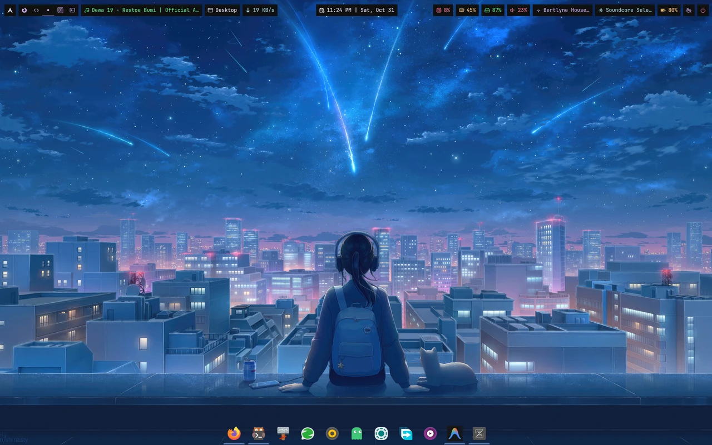

<div align="center">

# hyprland-dock

**A lightweight, blazing-fast, and modern dock for [Hyprland](https://hyprland.org)**  
*Built with Rust, GTK4, and gtk4-layer-shell.*

[](https://www.rust-lang.org/) [](https://gtk.org/) [](https://wayland.freedesktop.org/) [](LICENSE)

<br/>

<br/>
<br/>
<a href="https://ik.imagekit.io/ExoAcox/hyprland-dock.mp4?updatedAt=1793511623076"><b>Watch Demo Video</b></a>

</div>

---

## ✨ Features

- **Blazing Fast & Low Memory Footprint**: Native Rust binary with immediate startup and minimal resource usage.
- **Hyprland IPC Native Integration**: Listens directly to Hyprland's `socket2.sock` event stream for instant, zero-lag window tracking, state synchronization and live window preview.
- **Smart Auto-Hide**: Automatically slides out when tiled windows occupy the active workspace, and slides back in when you approach the screen edge hotzone or switch to an empty/floating workspace.
- **Rich Context Menu**: Right-click any icon to launch a new instance, close the window, pin/unpin from the dock, edit launcher settings (command, label, icon) in a modal, or lock/unlock icon positions.
- **Full GTK4 CSS Theming**: Fully customizable styling via `~/.config/hyprland-dock/style.css` with live reloading.

---

## 📦 Prerequisites

Ensure you have the following system libraries installed on your system:

### Arch Linux
```sh
sudo pacman -S rust cargo gtk4 gtk4-layer-shell grim
```
### Debian / Ubuntu
```sh
sudo apt install cargo libgtk-4-dev libgtk4-layer-shell-dev grim
```

### Fedora
```sh
sudo dnf install cargo gtk4-devel gtk4-layer-shell-devel grim
```

---

## 🚀 Installation

### One-Line Install (Recommended)
Automatically builds and installs `hyprland-dock` system-wide to `/usr/local/bin`:
```sh
curl -sSL https://raw.githubusercontent.com/ExoAcox/hyprland-dock/master/install.sh | bash
```

### Via Cargo
```sh
cargo install --git https://github.com/ExoAcox/hyprland-dock.git
```

---

## 🖥️ Usage

Run the dock directly from your terminal:
```sh
hyprland-dock
```

### Autostart with Hyprland

**Lua Configuration (`~/.config/hypr/autostart.lua`):**
```lua
hl.exec_cmd("hyprland-dock")
```

**Backdrop Blur (`~/.config/hypr/windowrule.lua`):**
```lua
hl.layer_rule({
    match = { namespace = "hyprland-dock" },
    blur = true,
    ignore_alpha = 0.2,
})
```
*(Or legacy `hyprland.conf`: `layerrule = blur, hyprland-dock` & `layerrule = ignorealpha 0.2, hyprland-dock`)*

---

## ⚙️ Configuration

Configuration files are located in `~/.config/hyprland-dock/` and are automatically generated with sensible defaults on the first launch.

### 1. `dock.conf` (Settings)
Located at `~/.config/hyprland-dock/dock.conf`:
```toml
icon_size = 36          # Icon dimension in pixels
anchor = "bottom"       # "bottom" | "top"
animation_ms = 130      # Slide in/out animation duration in milliseconds
icon_theme = "Papirus"  # Icon theme override (e.g. "Papirus", "Adwaita", "Tela")
locked = false          # If true, locks dock icons and disables drag-and-drop reordering
window_preview = true  # Show live window thumbnail preview on hover
window_preview_width = 360 # Preview thumbnail width in pixels
window_preview_delay = 200 # Hover delay in milliseconds before showing preview
```

### 2. `apps.conf` (Pinned Launchers)
Located at `~/.config/hyprland-dock/apps.conf`. Defines apps that stay pinned on the dock even when not running:
```csv
# Format: class,command,label,icon
firefox,firefox,Firefox,firefox
kitty,kitty,Kitty,
thunar,thunar,Thunar,
```
- **class**: Window class as reported by `hyprctl clients` (or app ID).
- **command**: Executable binary or launch command.
- **label**: Custom display name / tooltip label (leave empty to fallback to class name).
- **icon**: Icon theme name (leave empty to use the app's default icon directly).

*Running applications that are not pinned will automatically appear at the end of the dock.*

### 3. `style.css` (Custom Theming)
Located at `~/.config/hyprland-dock/style.css`. Customize colors, borders, hover animations, and popovers using standard GTK4 CSS selectors:

| Selector | Description |
| :--- | :--- |
| `window.dock-window` | Top-level Wayland layer-shell window container |
| `.dock` | Horizontal container box for icons |
| `.dock.has-window` | Background pill container when revealed over windows |
| `.dock button.dock-btn` | Individual icon launcher button |
| `.dock button.dock-btn:hover image` | Icon hover transform / zoom animation |
| `.dock button.dock-btn.running` | Indicator bar for open windows |
| `.dock button.dock-btn.active` | Indicator bar for currently focused window |
| `.dock button.dock-btn.drop-target` | Target indicator line during drag-and-drop |
| `popover.dock-tooltip` | Hover tooltip popup |
| `popover.dock-popover` | Right-click context menu popup |

---

## 🤝 Contributing

Contributions, bug reports, and suggestions are warmly welcomed!
1. Fork the repository
2. Create your feature branch (`git checkout -b feature/amazing-feature`)
3. Commit your changes (`git commit -m 'Add amazing feature'`)
4. Push to the branch (`git push origin feature/amazing-feature`)
5. Open a Pull Request

---

## 📄 License

Distributed under the [MIT License](LICENSE). Copyright (c) 2026 Anas Arifin.
